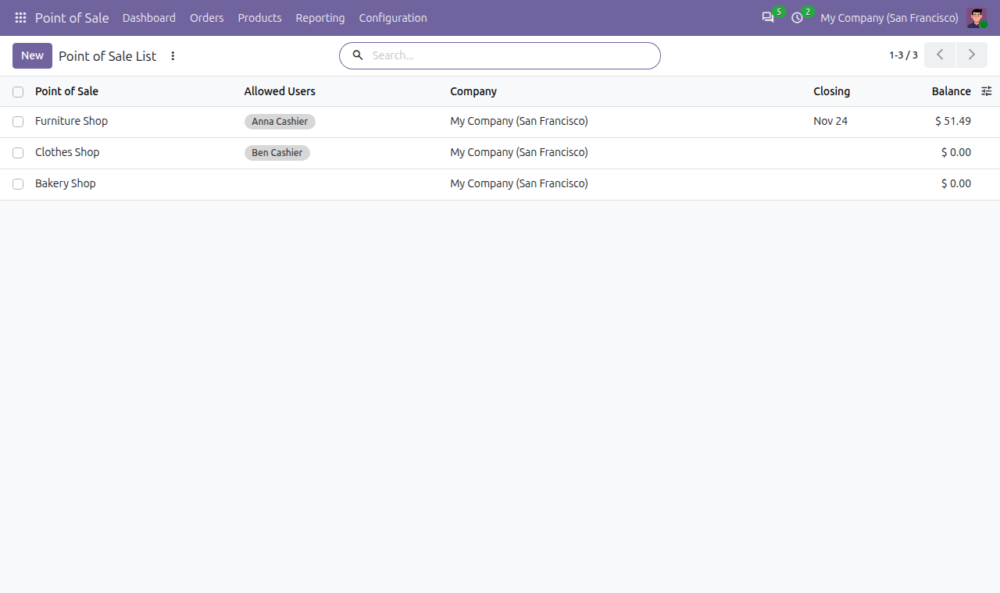

# POS Shop Access per User

Each Point of Sale shop gets an **Allowed Users** list. Cashiers only see and open the shops that
list them (or shops with an empty list). Point of Sale and Settings administrators always see every shop.

## Features

- Allowed Users in Point of Sale > Configuration > Settings, and as a column in the shop list.
- A direct link (`/pos/ui/<id>`) to a shop the user is not allowed in redirects to the dashboard
  without opening a session.
- Empty list: every Point of Sale user, as in standard Odoo.

## Requirements

- Odoo 20, Community or Enterprise. Depends on `point_of_sale`.

## Configuration

1. Point of Sale > Configuration > Settings, choose the shop.
2. Fill in **Allowed Users**, save.
3. Users in that list (Point of Sale / User) now only see their shops.

## Screenshots

